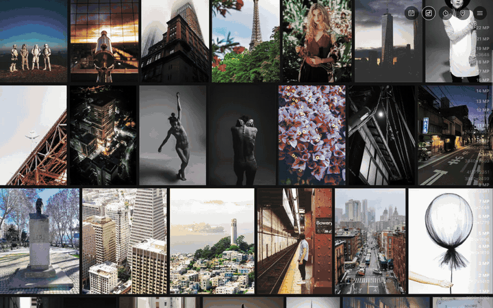

# Perceptrail

**Perceptrail** is a self-hosted photo gallery for large libraries. Instead of
albums and folders it is one endless sheet of your photos, and you choose the point
of view — by date, by place, by size; people, objects and colour come with ML. Each
view is a **perceptor**, a plugin that knows one thing about a photo and orders the
sheet by it. From any photo you can switch the view and stay on that photo.



It reads your libraries and never writes to them: a plain folder, Apple Photos (on
a Mac), Immich (through its API).

**Status**: before its first release (0.2.0). It runs every day on its author's
library; the install and the config may still change.

## What works now

- **The gallery**: one sheet of every photo and video, a justified grid that keeps
  its place on a resize, fast on tens of thousands of items (the list is cached in
  the browser and synced by its changes), several tabs at once.
- **Views (perceptors)**: date, size, duration, places (from GPS: sections by
  region and city), each with its sections; more as plugins.
- **The viewer**: photos, videos, Live Photos (the motion plays on a tile), an info
  panel with what each perceptor knows, every file of an item to download.
- **Libraries**: plain folders (one or several), RAW + JPEG pairs, edits and
  sidecars kept together as one item; Apple Photos (its database, its files, and
  what is in iCloud through PhotoKit — on a Mac, the native server); Immich (its
  timeline, previews and playback through our server — its key never reaches the
  browser).
- **Renditions** for a plain folder: photos as WebP in two sizes (from a RAW's
  embedded preview when it is big enough), videos as H.264 any browser plays, HDR
  tone mapped, a poster each. Libraries that make their own (Apple, Immich) are not
  rendered again.
- **Docker**: two images, one compose file.

## Planned

- **ML**: faces first, then the **trail** — from a photo to the nearest one you have
  not seen, then the nearest to that; colour, objects.
- A perceptor's own UI (a map for places), what other tools wrote into sidecars
  (ratings, keywords, faces), metadata editing, batch operations.
- Hardware video encoding (VAAPI / QSV, NVENC, VideoToolbox).
- PostgreSQL beside SQLite.

The whole list: [roadmap](_sb/docs/roadmap.md).

## Install

Docker, in a directory of its own:

```bash
curl -fsSLO https://raw.githubusercontent.com/eggs-gd/Perceptrail/master/compose.yml
docker run --rm --entrypoint cat ghcr.io/eggs-gd/perceptrail-server /etc/perceptrail/config.yml > config.yml
docker compose up -d    # then http://<host>:8080
```

Your photos, other libraries, updates, a Mac with Apple Photos:
[docs/install.md](docs/install.md). All the docs: [`docs/`](docs/README.md).

## Inside

- **Server** (`gontroller`): Go; metadata by ExifTool, renditions by libvips and
  ffmpeg. The storage is database-agnostic (GORM behind the model): SQLite now,
  PostgreSQL planned.
- **Gallery** (`svebapp`): SvelteKit, a single-page app; the list lives in
  IndexedDB, the layout in web workers.
- **Perceptors**: built in, or Go plugins on [`perceplib`](perceplib/README.md).

The project's page: [perceptrail.eggs.gd](https://perceptrail.eggs.gd). Changing the
code: [CONTRIBUTING.md](CONTRIBUTING.md).

## License

[Mozilla Public License 2.0](LICENSE).
